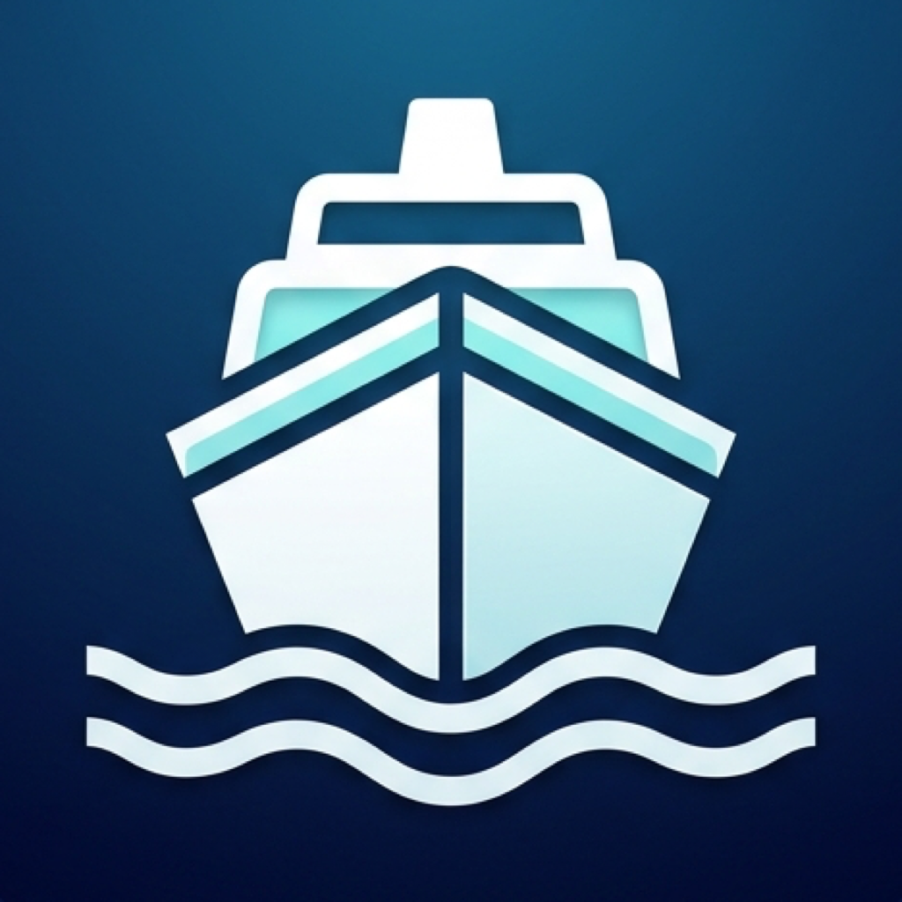

<p align="center">
  
</p>

# Harbor 🚢

[](LICENSE)
[](https://apple.com)
[](https://swift.org)

> A lightweight macOS Menu Bar companion for Xcode Device Hub.
> Bridges the gap between macOS and simulator runtimes with instant drag-and-drop file imports, batch queueing, and bidirectional clipboard synchronization.

---

## Features

### 1. 📦 Multi-File Drag & Drop Routing
- **Media (Images & Videos)**: Drag `.jpg`, `.png`, `.heic`, `.mp4`, `.mov`, etc. onto Harbor's floating drop window to import directly into the simulator's Photos library via `xcrun simctl addmedia`.
- **App Bundles (`.app`)**: Drag built `.app` bundles to instantly install them via `xcrun simctl install`.
- **Push Notifications (`.apns`)**: Drop an `.apns` JSON payload; Harbor detects the `"Simulator Target Bundle"` and fires a simulated push notification.
- **Documents & Raw Files**: Direct routing into the active app's `Documents` sandbox container.

### 2. 🪟 Draggable & Collapsible Floating Drop Window
- An always-on-top, translucent floating window that stays above Xcode and Device Hub.
- Freely draggable anywhere on screen; remembers its position across restarts.
- **Sticky-Notes Style Collapse**: Shrink down to a slim 44pt title strip when working, expand whenever you need full file queue management.
- Batch multiple files together and send in a single click.

### 3. 📋 Bidirectional Clipboard Sync
- **Mac → Simulator**: Instantly sends your Mac's pasteboard into the active simulator (`xcrun simctl pbcopy`).
- **Global Hotkey**: Press `Option + Shift + V` (`⌥⇧V`) anywhere on your Mac to sync your clipboard into the simulator without opening any menus.
- **Simulator → Mac**: Pulls text from the simulator's pasteboard back to macOS with one click.

### 4. ⌨️ Simulator Keyboard & Shift Fix
- One-click reset to flush stuck modifier keys (`Shift`, `Option`, `Command`) caused by Xcode Device Hub's multi-simulator window focus desync.
- Re-syncs the virtual HID keyboard stream and re-asserts window focus.

---

## Installation & First Launch 🚀

1. Download **`Harbor.zip`** from the [Latest Release](https://github.com/anurag0713/Harbor/releases).
2. Unzip and drag `Harbor.app` into your `/Applications` folder.
3. Open Harbor:
   - **Where to look:** Harbor is a lightweight Menu Bar utility (`LSUIElement`). It does not appear in the Dock; look for the **ferry/ship icon** in the **top-right macOS Menu Bar** near your clock and Wi-Fi icons.
   - **First Launch Note (Gatekeeper):** Because Harbor is open-source and not signed with an Apple Developer certificate, macOS may show an *"Apple could not verify Harbor"* warning.
     - Either open **System Settings → Privacy & Security** and click **"Open Anyway"**.
     - Or run: `xattr -cr /Applications/Harbor.app`

---

## Requirements & Building

- macOS 14.0+ (Sonoma or later)
- Xcode 16.0+ (supports Xcode 27 Device Hub)
- Built with pure SwiftUI & AppKit — zero external dependencies.

### Generate Xcode Project & Build
```bash
# Generate the .xcodeproj using xcodegen
xcodegen generate

# Build Debug app
xcodebuild -project Harbor.xcodeproj -scheme Harbor build CODE_SIGNING_ALLOWED=NO
```

---

## Contributing 🤝

Contributions are very welcome! Whether it’s reporting a bug, proposing a new feature to fix another Device Hub quirk, or submitting a pull request, your input helps make simulator testing smoother for everyone.

### How to Contribute:
1. **Feature Requests & Ideas**: Have an idea or facing a Device Hub pain point not yet covered? Please [open an issue](https://github.com/anurag0713/Harbor/issues) describing the problem and what workflow it would improve.
2. **Bug Reports**: Found a bug? Open an issue with details about your macOS version, Xcode version, and steps to reproduce.
3. **Pull Requests**:
   - Fork the repository.
   - Create your feature branch (`git checkout -b feature/amazing-feature`).
   - Commit your changes (`git commit -m 'feat: add support for XYZ'`).
   - Push to your branch (`git push origin feature/amazing-feature`).
   - Open a Pull Request.

---

## License

This project is licensed under the MIT License — see the [LICENSE](LICENSE) file for details.
